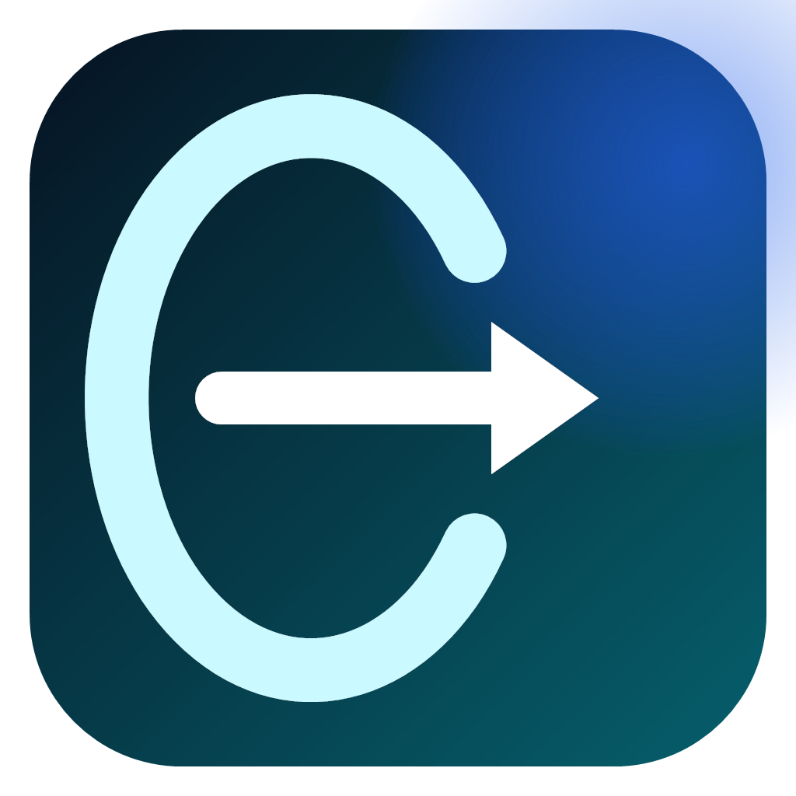
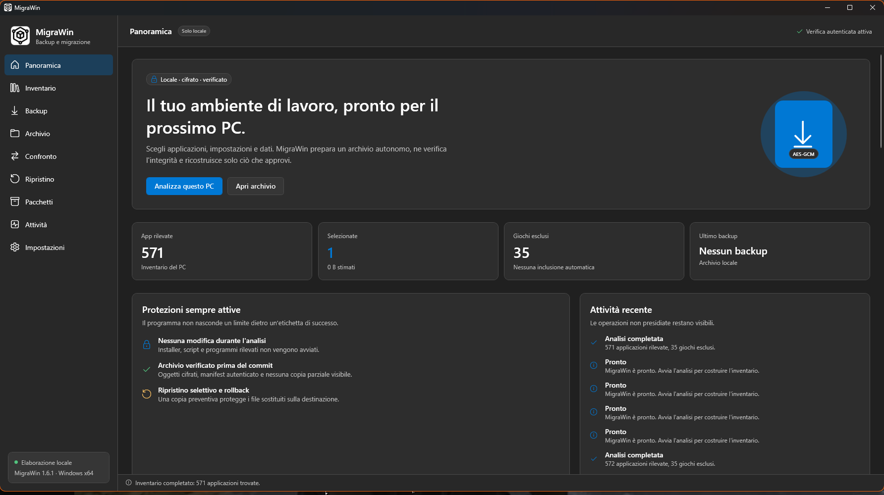
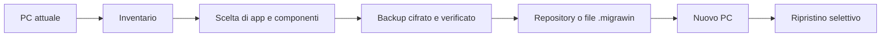
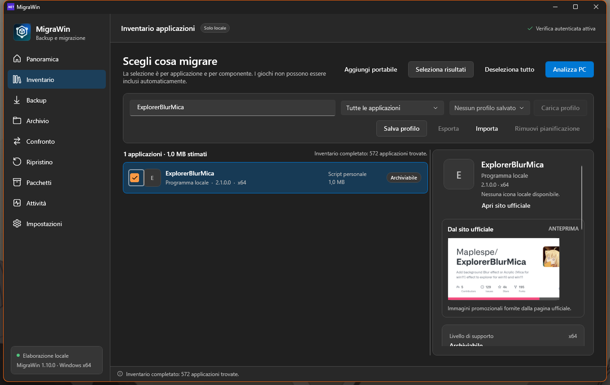
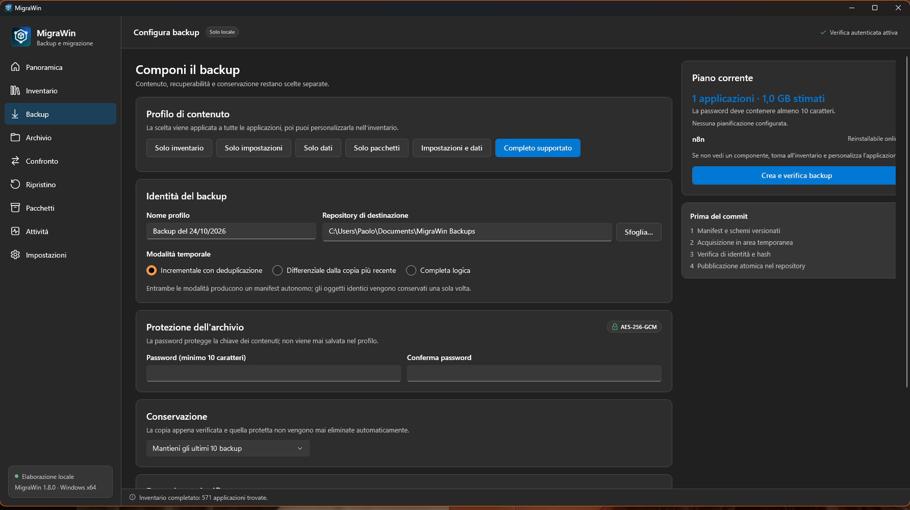
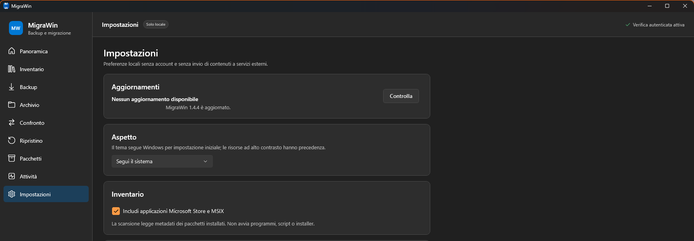

# MigraWin

<p></p>

**Backup e migrazione delle applicazioni Windows, con controllo, crittografia e ripristino selettivo.**

[](https://github.com/renegadeFree/MigraWin/actions/workflows/ci.yml)

[Scarica MigraWin 1.5.0](https://github.com/renegadeFree/MigraWin/releases/download/v1.5.0/MigraWin-1.5.0-x64.msi) · [Manuale](docs/MANUALE.md) · [Formato archivio](docs/REPOSITORY_FORMAT.md) · [Tutte le release](https://github.com/renegadeFree/MigraWin/releases)

[](docs/images/panoramica.png)

## Che cos'è MigraWin

Quando si cambia o si reinstalla un PC, reinstallare a mano applicazioni e configurazioni richiede tempo e porta facilmente a dimenticare qualcosa.

MigraWin crea una fotografia del computer a livello di applicazioni: mostra cosa è installato, permette di scegliere esattamente quali impostazioni, dati e installer conservare, quindi salva il risultato in un archivio cifrato e verificato. Sul nuovo PC si ripristina solo ciò che si approva.

Non è un clone del disco e non reinstalla Windows. È uno strumento locale, senza account cloud e senza telemetria.

## Obiettivi

- **Rendere visibile l'installato**: raccogliere applicazioni del Registro Windows, a 32 e 64 bit, e pacchetti Microsoft Store/MSIX.
- **Evitare copie indiscriminate**: scegliere per ogni applicazione solo le componenti utili.
- **Proteggere il trasferimento**: cifrare i contenuti, verificare l'integrità e permettere il recupero senza dipendere da un'unica password.
- **Ripristinare con controllo**: applicare mappature dei percorsi, gestire i conflitti e conservare una copia di rollback.
- **Essere trasparente**: dichiarare il livello di supporto reale invece di presentare ogni applicazione come migrabile automaticamente.

## Come funziona



1. **Analizza il PC.** MigraWin legge l'inventario e indica quali applicazioni sono riconosciute, reinstallabili o solo rilevate.
2. **Scegli il contenuto.** Seleziona applicazioni e componenti; puoi aggiungere cartelle dati e programmi portabili.
3. **Crea il backup.** Scegli una destinazione e una password di almeno 10 caratteri. Al primo backup conserva la chiave di recupero fuori dal disco del repository.
4. **Trasferisci l'archivio.** Porta sul nuovo PC la cartella del repository oppure il singolo file `.migrawin`.
5. **Ripristina.** Controlla destinazioni e conflitti, quindi avvia un ripristino parziale o completo.

## Dentro l'app

### Inventario e scelta delle componenti

Cerca per nome, produttore o versione e riconosci ogni applicazione dalla sua icona. Nella scheda puoi vedere la versione installata, aprire la pagina ufficiale e consultare le immagini promozionali senza alterare l'icona del programma.

[](docs/images/inventario.png)

### Backup leggibile prima di essere avviato

Il profilo di contenuto, la destinazione, la modalità incrementale e la conservazione restano scelte separate. Prima del salvataggio, MigraWin verifica manifest, hash e integrità degli oggetti.

[](docs/images/backup.png)

### Aggiornamenti semplici

Da **Impostazioni → Aggiornamenti** il programma controlla l'ultima release pubblica, scarica l'MSI solo dopo conferma e verifica il file con `SHA256SUMS.txt` prima di avviare l'installazione.

[](docs/images/aggiornamenti.png)

## Funzioni principali

| Area | Cosa offre |
| --- | --- |
| Inventario | Registro Windows a 32/64 bit, Store/MSIX, ricerca, filtri, selezione multipla e applicazioni portabili |
| Schede applicazione | Icona locale, versione, collegamento ufficiale e galleria di immagini prodotto |
| Selezione | Componenti per applicazione, cartelle dati aggiuntive, esclusioni persistenti e profili importabili/esportabili |
| Backup | Copia completa, incrementale o differenziale con deduplicazione |
| Protezione | Oggetti AES-256-GCM, manifest autenticati, password PBKDF2 e chiave di recupero indipendente |
| Ripristino | Selezione per app e componente, mappatura percorsi, politiche di conflitto e copie di rollback |
| Archivio | Verifica, cambio password, conservazione configurabile ed esportazione `.migrawin` |
| Automazione | Backup giornaliero tramite Utilità di pianificazione con credenziale protetta da DPAPI |
| Trasparenza | Rapporti Markdown/JSON, cronologia SQLite e confronto tra snapshot |
| Interfaccia | Tema chiaro/scuro, navigazione da tastiera, layout compatto e MSI per l'utente corrente |

## Installazione

Requisiti: **Windows 11 x64**.

1. Scarica [MigraWin 1.5.0 x64](https://github.com/renegadeFree/MigraWin/releases/download/v1.5.0/MigraWin-1.5.0-x64.msi).
2. Apri l'MSI. L'installazione avviene per l'utente corrente e non richiede privilegi amministrativi.
3. Avvia MigraWin dal menu Start.

Puoi verificare il download:

```powershell
Get-FileHash .\MigraWin-1.5.0-x64.msi -Algorithm SHA256
```

Hash SHA-256 della release 1.5.0:

```text
7829A41B7A7191410FB16B52D9D10A64F5159FBD2D9F8391FDC68BF2B5FE1678
```

> **Nota sulla firma digitale:** la release corrente non ha una firma Authenticode di distribuzione. Windows può quindi mostrare un avviso SmartScreen. La pipeline di firma è pronta e viene attivata quando è disponibile un certificato valido.

## Privacy e sicurezza

- I dati restano sul PC: non ci sono account, cloud o telemetria.
- La password non viene salvata nei profili; dal secondo accesso serve la password oppure la chiave di recupero.
- Le configurazioni che possono contenere token o password sono escluse per impostazione predefinita.
- Le credenziali delle applicazioni non vengono estratte automaticamente.
- Le immagini promozionali vengono richieste solo quando si apre la scheda di un'app con sito ufficiale disponibile.
- Gli archivi importati sono controllati contro percorsi malevoli, traversal e collegamenti simbolici.
- Gli aggiornamenti vengono accettati solo dopo verifica del checksum pubblicato.

## Supporto dichiarato

Il catalogo riconosce configurazioni specifiche per Visual Studio Code, Windows Terminal, Git, PowerShell, Notepad++, OBS Studio, Paint.NET, LibreOffice, FileZilla e Sublime Text.

Essere riconosciuta non significa che ogni dato possa essere trasferito automaticamente. Le prove end-to-end più estese riguardano Git e Notepad++; per le altre applicazioni il livello effettivo è mostrato nell'inventario. Le applicazioni non riconosciute possono comunque essere archiviate tramite cartelle esplicite.

## Limiti e perimetro

- Non crea immagini del disco e non clona Windows.
- Non reinstalla automaticamente un'applicazione se non è disponibile un installer o un meccanismo di reinstallazione adatto.
- Non garantisce il trasferimento di credenziali, licenze o configurazioni non dichiarate come supportate.
- I giochi non vengono inclusi automaticamente.
- Sono fuori perimetro WSL, container Docker e macchine virtuali.
- Windows 10 e Windows ARM64 non sono dichiarati supportati.
- La release 1.5.0 non è firmata con un certificato Authenticode.

## Sviluppo e collaudo

Requisiti: Windows 11 x64, .NET 10 SDK e PowerShell.

```powershell
.\build.ps1
```

Il comando pubblica l'app, genera l'MSI e, se è disponibile un certificato configurato, firma exe e installer.

Per eseguire solo i test:

```powershell
dotnet run --project tests\MigraWin.Tests\MigraWin.Tests.csproj -c Release
```

La suite copre crittografia, password errata, recupero, deduplicazione, backup incrementale e differenziale, archivi `.migrawin`, percorsi ostili, conservazione, DPAPI, pianificazione, conflitti, rollback e rilevamento di oggetti manomessi.

## Documentazione

- [Manuale utente](docs/MANUALE.md)
- [Formato del repository](docs/REPOSITORY_FORMAT.md)
- [Changelog](CHANGELOG.md)
- [Piano di sviluppo](PLAN.md)
